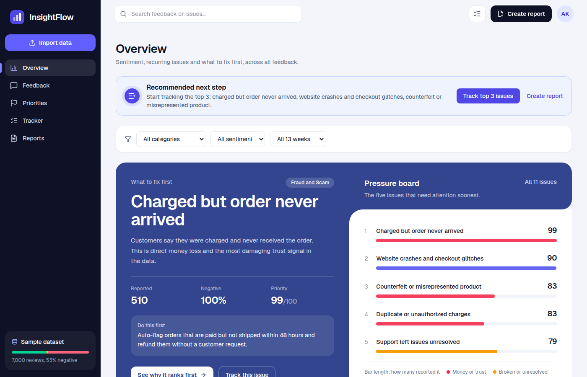
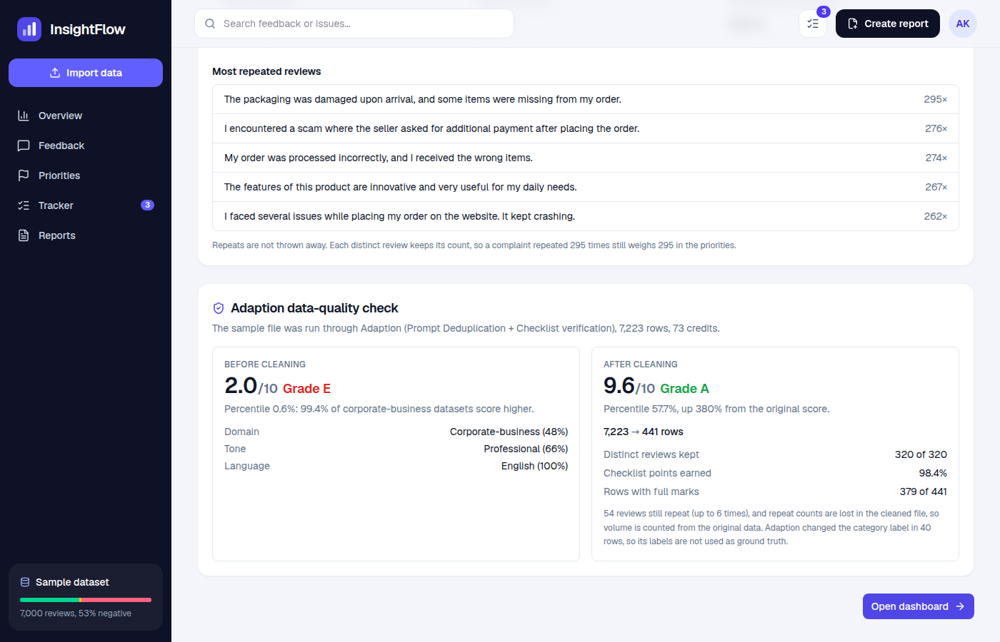
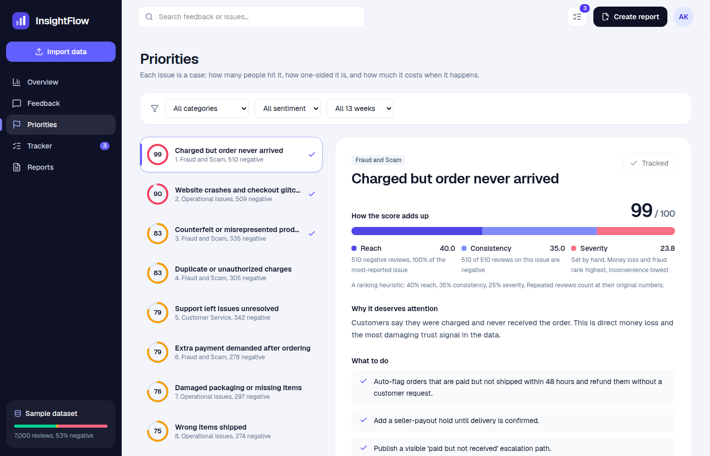

# InsightFlow

**Turn raw customer feedback into decisions: what to fix first, and why.**

Live app: **https://insightflow-blond.vercel.app**
Built for Build Battle 2026 (Frontend Arena, AI × Web Development).



## What it does

| Requirement | Where it lives |
|---|---|
| **Feedback management**: submit, import CSV, search, filter, sample data | `New session` popup (upload CSV, paste, add one), `/feedback`, "Use sample data" on `/import`. Each import can be its own **session** with its own dashboard, tracker and reports |
| **AI-powered analysis**: sentiment, topics, grouping, Adaption | Issue groups and sentiment for all 320 distinct reviews; a key-free matcher for new feedback; Adaption cleaning on `/import` |
| **Analytics dashboard**: metrics, sentiment, issues, trends, filters | `/overview`: category, sentiment and period filters drive every widget |
| **Recommendations**: priorities with a reason | `/priorities`: ranked issues, the score arithmetic, quotes, and actions |
| **Reports and tracking**: save/track, export | `/tracker` (drag cards between columns), `/reports` (print to PDF, CSV export, **copy summary** to share in chat or email, saved reports you can reopen and delete) |

## The dataset, and why cleaning comes first

The sample file has 7,000 reviews but only **320 distinct** ones. A few sentences repeat hundreds of times, so treating rows as customers gives the wrong ranking.

- Every distinct review keeps its **original repeat count**, so a complaint said 295 times weighs 295.
- The file was run through **Adaption** (Prompt Deduplication + Checklist verification). Quality went **2.0 → 9.6 out of 10** (grade E → A, percentile 0.6 → 57.7), and 7,223 rows became 441. See [docs/ADAPTION.md](docs/ADAPTION.md) for the full explanation, including where Adaption fell short.



## How priorities are decided

```
score = 100 × (0.40 × volume + 0.35 × negative share + 0.25 × severity)
```

- **volume**: negative reviews for the issue ÷ the most-reported issue, using original repeat counts
- **negative share**: how one-sided the feedback on that issue is
- **severity**: set by hand (money loss and fraud rank highest, inconvenience lowest)

It is a ranking heuristic, not a measurement, and the app shows the arithmetic for every issue.



## What is real, and what is not

Being plain about this matters more than sounding impressive.

- **No model runs in the browser or on the server at request time.** The deployed app needs no API keys.
- **Sample labels** (sentiment, issue group, severity) come from `scripts/label.mjs`: rules written after reading all 320 distinct reviews. I cross-checked them with a live language model (DeepSeek, `scripts/validate-llm.mjs`): **sentiment agreed on 318 of 320 reviews (99%)**. The model used finer issue names (74 vs my 21), so the curated groups are kept for stability. The model output is committed in `data/llm-labels.json`.
- **New feedback** is matched against the 320 labeled reviews with TF-IDF similarity (`src/lib/match.ts`), with no key. Leave-one-out accuracy on the sample: **88% on issue, 96% on sentiment**. When nothing is close it says so, and those reviews are **grouped with each other by similarity into new issues** (`src/lib/group.ts`). Those groups are named after their most-repeated review and get a severity from keywords (money and fraud words rank highest), so any dataset gets a ranking. The names are rough, not written by a model.
- **Trends are simulated.** The sample has no dates, so the weekly timeline is a seeded random spread across 13 weeks, and the chart is labelled "Demo timeline (simulated)".
- `src/lib/analyze.ts` has a server-side model labeling function (AI SDK + DeepSeek, schema-validated) that is **not wired into the UI**.
- Data you add, track or save stays **in your browser** (localStorage). Nothing is sent anywhere. The avatar menu (top right) clears the current session or resets everything, so the app can be reset between demos.
- There is no shareable link: reports are shared by copying the summary, printing to PDF or exporting CSV, because a link would need a server to store the report.

## Details worth knowing

- **Duplicate protection**: uploading the same file again is detected ("320 of 320 distinct reviews are already in your dashboard") and skipped, so counts never double.
- **Personal data**: emails, phone numbers and card-like numbers are masked as `[email]`, `[phone]`, `[card]` before anything is stored.
- **Honest limits**: auto-grouped issues have plain names (a representative review, not a written label) and keyword-based severity, so check them before acting. Imported data has no dates, so only the sample shows a (simulated) weekly timeline.

## Run it

```bash
npm install
npm run dev          # http://localhost:3000
npm run build && npm start
```

No environment variables are required. To re-run the offline model cross-check, put `DEEPSEEK_API_KEY` in `.env.local` and run `node --env-file=.env.local scripts/validate-llm.mjs`.

## Tests

A browser test walks the full flow (filters, tracking, drag and drop, search, CSV export, saved reports, the import popup, personal-data flagging, duplicate protection):

```bash
npm start                                  # in one terminal
node scripts/smoke.mjs                     # or: BASE=https://insightflow-blond.vercel.app node scripts/smoke.mjs
```

A second test covers the phone layout (bottom bar, bottom-sheet popup, card lists, swipeable rows, no sideways scroll at 320 to 414px wide):

```bash
node scripts/phone.mjs                     # or: BASE=https://insightflow-blond.vercel.app node scripts/phone.mjs
```

## Stack

Next.js 16 (App Router, TypeScript), Tailwind CSS 4, Recharts, PapaParse, zod, Playwright (tests). Deployed on Vercel.

## Repository map

```
src/app/           pages: overview, feedback, priorities, tracker, reports, import
src/components/    shell, import popup, filters, shared UI
src/lib/           data layer, store, matcher, scan, Adaption results
scripts/           dedupe → label → build-analysis pipeline, Adaption summary, tests
data/              sample.csv, analyzed.json, Adaption summary + trimmed output
docs/              ADAPTION.md, DEMO.md, screens/, planning/ (early notes)
```

Data pipeline: `node scripts/dedupe.mjs && node scripts/label.mjs && node scripts/build-analysis.mjs` regenerates `data/analyzed.json` from `data/sample.csv`.
